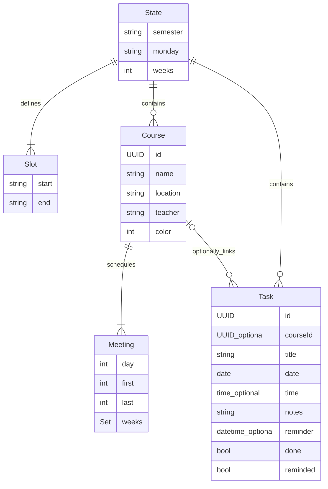

# 第一版产品与技术设计

## 已确认的需求

安卓原生、手机自用、本机保存。以课程表为首页，日程页按截止时间汇总作业、报告、考试等任务。允许个人任务。课程内默认展示这门课所有未完成任务。日期必填，具体几点选填；每次添加时自行决定提醒。提供文件备份/恢复。教务导入后置。

## 页面与操作

| 页面 | 主要内容 | 核心操作 |
|---|---|---|
| 课程表 | 学期、第 N 周、日期范围、周一至周日与每日节次 | 上下/左右浏览、切换周、回到本周、点课程 |
| 课程详情 | 地点、教师、全部上课时段、所有未完成任务 | 添加关联任务、编辑课程、查看已完成 |
| 日程 | 未完成数量、逾期数量、按截止日期分组的任务 | 切换待完成/已完成、勾选、点开修改 |
| 设置 | 学期作息、课程管理、通知权限、备份恢复 | 改学期、编辑课程、导出、预览恢复 |

全局右下角浮动「＋」同时提供添加任务和添加课程；顶栏通过学期名称切换学期，不再放置重复加号。课程详情中的「添加任务」自动选中课程。空课格点击后预填星期和节次。

窄屏每个星期保留至少 76dp 宽度，因此一周需要横向滑动；这是第一版对课程名称可读性的选择。连续多节且课程集合相同的格子合并为大块，显示完整节次和时间范围；遇到重叠课程变化时保留分段。时间重叠不会静默覆盖，保存前提示，课格列出重叠数量并提供选择。

## 视觉规范

浅灰背景 `#F6F7FB`、白色圆角卡片、主色 `#5856D6`；课程从六种低饱和色选择。标题 28sp、正文 14–16sp、次要信息 12–13sp。主要按钮触控高度约 48dp，浮动添加按钮 56dp。使用原生滚动容器、日期/时间选择器和对话框。中文优先，V1 不提供多语言和深色主题切换。

参见 `design/ui-v1.svg`。设计图使用示例数据，是信息结构示意，非 APK 截图。

## 返回层级与阅读位置（0.2.1）

课程详情打开编辑课程或添加/编辑任务时保留上一层，取消只退出表单，保存后刷新详情。三个主页面分别记住纵向滚动位置，课表另记横向位置；切页、刷新和 Activity 重建可恢复，完整退出后重新启动不承诺恢复。设置页保留现有分组布局。

## 多学期（0.2.0）

课程表、日程页仅显示当前所选学期，所有学期的提醒仍会运行。名称下方可切换，设置内可新建、编辑、删除，至少保留一个学期。点击通知自动切到对应学期。备份覆盖全部学期。

## 单学期内部数据模型

每门课独立 ID，多次上课通过 Meeting 描述。任务关联 Course ID，不关联某次 Meeting，因此跨周作业不会漏掉。任意教学周集合独立于单双周快捷选择。

## 时间与状态语义

- 第一教学周从用户指定的周一开始；当前周使用日期差向下取整。学期外提示，浏览定位在首/末周。
- 日期使用 `java.time` 本地日历，不把教学周简单换算成固定毫秒数。
- 无具体截止时间：按当日本地时间的最后一刻排序，下一天开始算逾期。相同日期有具体时间的任务先排。
- 提醒是手机本地日期时间，保存时不得晚于截止，也不得是过去时间；备份可包含历史提醒记录。
- 改系统时区后，未来提醒按新时区的相同本地时间重建。重新安排时补发过去 24 小时内尚未送达、未完成的提醒，更早的提醒不补发。
- 完成/删除任务取消提醒；重新打开任务只重建尚未送达、仍在未来的提醒。
- 删除课程保留所有任务，解除课程关联；删除前明确提示。
- 减少学期周数/每日节数时，如课程超出范围，拒绝保存并提示先修改课程，不裁剪现有课程。

## 存储、备份和恢复

V1 使用 Android `AtomicFile` 存储单个带版本的 JSON 快照。面向个人低数据量，省去数据库迁移与第三方 ORM；未来可在 Store 边界替换为 SQLite/Room。

备份 envelope：`format = schedule++`、`version = 2`、`activeSemesterId` 和 `semesters` 数组。每个学期独立保存作息、课程、任务与备注；读取兼容 V1，旧数据自动视为一个学期。导入先限流读取（2MiB）、检查嵌套层数，再解析、校验版本/ID/日期/引用/周次/节次等，全部通过后展示课程和任务数量，由用户确认替换。失败不会写入原文件。写入成功后重建未来提醒。

文件读写通过 Android Storage Access Framework，由用户选择位置，不申请广泛存储权限。系统自动云备份与设备自动转移已关闭，显式导出由用户决定。

## 提醒权限

使用 AlarmManager 和 NotificationChannel，不持续运行后台服务。首次保存带提醒任务时申请通知权限；未授予会显示原因。Android 12+ 无精确闹钟权限时使用不精确提醒，设置页明确显示可能延迟，并提供系统授权入口。不使用面向闹钟应用的强制全屏提醒。

## 后续教务导入边界

后续导入器先输出独立的待确认课程草稿，再走现有规则校验和保存流程。第一版不包含教务账号、密码、远程脚本执行、WebView 或学校网络请求。具体教务协议需要拿到学校网站后单独设计与审查。
